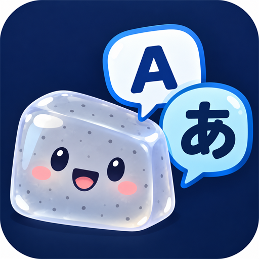

# Konyaku Jelly



Dalamud plugin for FFXIV that translates chat with Google Translate. Free, no key, no login.

**📖 Illustrated tutorial: https://gnomerock.github.io/konnyaku-jelly/**

- **Read chat**: Party and Alliance chat (plus FC, Tells, LS, CWLS … if you turn them on) is translated into your language (default: English) and shown in the Konyaku Jelly window.
- **Write chat**: type in your own language, pick a channel from the **To** dropdown, and it goes out translated (default: Japanese).
- **Paste**: translate any Japanese text you copied, e.g. from a website or a Discord message.
- **Party Finder**: right-click a listing in the game's Party Finder → **Translate**.
- **Light on requests**: by default chat is only translated while the window is open.
- Languages: English and Japanese both ways. Chat you read can also be translated into Thai. It shows in the Konyaku Jelly window, not in game chat, because the game's font has no Thai letters.

---

## Tutorial

### 1. Install

1. In game, type `/xlsettings` → **Experimental** tab.
2. Under **Custom Plugin Repositories**, paste:
   ```
   https://raw.githubusercontent.com/gnomerock/Gnomod/main/repo.json
   ```
   tick **Enabled**, click **+**, then **Save and Close**.
3. Type `/xlplugins` → **All Plugins** → search for **Konyaku Jelly** → **Install**.

### 2. Check the connection

There's nothing to set up: translations come from Google Translate, free, with no key or login. To check it works, open **Settings** in the window's sidebar and click **Test connection** on the **Translator** tab. You should see `It works! → ありがとう…`.

### 3. Open the window

Type `/jelly`. Keep this window open while you play: incoming chat is only translated while it's open, so chat you never read isn't sent to Google. You can turn that off in **Settings → Chat**.

**Jelly tab:** a small vertical **Jelly** tab sits on the **left edge of the screen**. Click it and the window slides out from that edge like a drawer, covering the tab. Close the window (✕) and the tab comes back. Drag the tab (it wobbles like jelly) along the **left or right edge** to move it, or drag it **out onto the screen** and it turns into a normal window where you drop it. Drag that window against a screen edge and let go to dock it as a drawer again. In **Settings → Look** you can turn the tab off, put it back on the left edge, or turn off the drawer.

The **sidebar** on the left of the window has:

- The pages: **Chat** and **Paste**. A red dot on Chat means new translations arrived while you were on another page.
- **Translating / Paused** at the bottom, to pause and resume chat translation.
- **Clear log** and **Settings**.
- The **«** button at the top collapses the sidebar to icons only, to save space. Click **»** to expand it again.

### 4. Read chat

Messages from the channels you picked show up on the **Chat** page, translated, with a coloured channel badge, the sender and the time. The original text is shown underneath in grey.

- **Right-click** a line to copy the translation.
- Messages already in your language are skipped.
- The game's auto-translate phrases (the ones between green and red arrows) already show in your language, so they're left out of what is translated. A message made only of them isn't sent at all.

### 5. Write chat

At the bottom of the **Chat** page:

1. Pick a channel in the **To** dropdown: Party, Say, Alliance, Free Company, Tell, Novice Network, Shout, Yell, LS1–8, CWLS1–8. The right side shows which language it will be sent in.
2. For **Tell**, also type who it's for, as `Name@World`.
3. Type your message in your own language and press **Enter** or **Send**. It's translated and sent.
4. Click **Copy** instead to translate it and copy it to the clipboard without sending, so you can check it first or paste it somewhere else.

**From the game's own chat box:** a small blue translate button sits just right of the game's chat input. Type your message there as usual (a channel command like `/p` or `/t Name@World` at the start is fine), then click the button. Your text is replaced with the translation, and you press **Enter** to send it. You can turn the button off in **Settings → Chat**.

### 6. Translate pasted text

Click **Paste** in the sidebar, paste Japanese text (Ctrl+V or the **Paste** button) and click **Translate to English**. **Copy** puts the result on your clipboard.

### 7. Party Finder

In the game's Party Finder, right-click a listing (or inside its details window) → **Translate**. The description is shown in English in your game chat, marked `[Jelly PF]`, and in the Konyaku Jelly log.

### 8. Commands

| Command | What it does |
|---|---|
| `/jelly` | Show or hide the Konyaku Jelly window |
| `/jelly <text>` | Translate into your outgoing language and copy it to the clipboard |
| `/jelly /p <text>` | Translate and send to party right away. `/s`, `/fc`, `/a`, `/l1`, `/cwl1`, `/t Name@World` … also work |

These work well in macros, e.g. `/jelly /p Thanks for the run!`.

### 9. Settings

- **Translator**: **Test connection**.
- **Languages**: **Chat I read** (English, Japanese or Thai) and **Messages I send** (English or Japanese).
- **Chat**:
  - Only translate while the window is open.
  - Skip your own messages.
  - Show the original text.
  - Echo translations into game chat (`[Jelly]`).
  - Translate button next to the game's chat box.
  - Which channels to translate. Only Party (including cross-world party) and Alliance are on by default. Tick FC, Tells, LS and the others if you want them. Be careful with Shout and Yell: busy cities send a lot of messages, and Google may start refusing requests.
- **Look**: the blue & white theme (turn it off to use your Dalamud style) and how many lines the log keeps.
- **DMU** (Dancing Mad Ultimate only):
  - **Enable DMU helper**: turns every feature below on or off.
  - **Auto-mark delay**: how long to wait before placing a mark, 0–2000 ms (500 ms by default). **Random delay** waits a different time between a Min and Max you set.
  - **Enable P2 auto-mark**: after you soak the 3rd tower, marks you `/mk ignore <me>` for the circle or `/mk bind <me>` for the cone.
  - **Enable P3 auto-mark**: marks you `/mk attack <me>`, `/mk bind <me>` or `/mk ignore <me>` for your 1st, 2nd or 3rd in Line debuff.
  - You can change every mark command. Its **Test** button sends it right away (after the delay), anywhere, so you can check it outside the fight.
  - **Enable P3 tether helper**: shows your role and which Black Hole tether to grab next. Pick the **Standard** or **Fae** strategy (Fae swaps the DPS and support tethers).
  - **Enable P4 debuff helper**: shows a tile for each of your P4 debuffs, as in DMU Helper: what to do (`Real: Stack`, `Go Black` …), the debuff icon framed in that colour, and its timer. Hover a tile for the full instruction. It also shows Chaos's **Tsunami/Inferno** cast (`Puddles first`, `Donuts second` …) and other players' **Cursed Shriek** gaze (`Look away from X` or `Face X`).
  - **Show example overlay**: shows a sample so you can drag the overlay into place.

### Tips and troubleshooting

- **"Something went wrong" in the window**: open Settings → **Test connection** to see the full error. If Google is refusing requests (too many messages), wait a while.
- **Nothing is translated**: check that the checkbox at the top of the window is ticked, that the window is open, and that the channel is ticked in **Settings → Chat**.
- **Fewer requests**: leave Shout/Yell off and keep "only translate while open" on. Identical messages are cached, so they're only translated once.

---

## Developers

### Translation backend

Translations use Google Translate's free web endpoint (`translate.googleapis.com/translate_a/single?client=gtx`), the same one many browser extensions use. It needs no key, but it isn't an official API, so Google may rate-limit or change it. A message already in the target language is detected from Google's detected source language and skipped. Translations are cached and at most 3 run at once.

### Build / dev install

Requires .NET 10 SDK and XIVLauncher with Dalamud installed (references come from `%APPDATA%\XIVLauncher\addon\Hooks\dev`).

```
dotnet build Konyakku/Konyakku.csproj -c Release
```

In game: `/xlsettings` → Experimental → Dev Plugin Locations → add
`D:\repo\konyaku\Konyakku\bin\Release\Konyakku.dll`, then enable it in `/xlplugins` → Dev Tools.

### Releasing

Push a version tag (4 parts, matching the assembly version):

```
git tag v0.4.0.0
git push origin v0.4.0.0
```

GitHub Actions builds the tagged commit, creates the release with `latest.zip`, and updates the Konyaku Jelly entry in [gnomerock/Gnomod](https://github.com/gnomerock/Gnomod)'s `repo.json`, so the update shows up in `/xlplugins`. This needs a `GNOMOD_TOKEN` secret in this repo that can write to Gnomod.

The tutorial site is `docs/index.html`, served by GitHub Pages from the `docs` folder on `main`.
